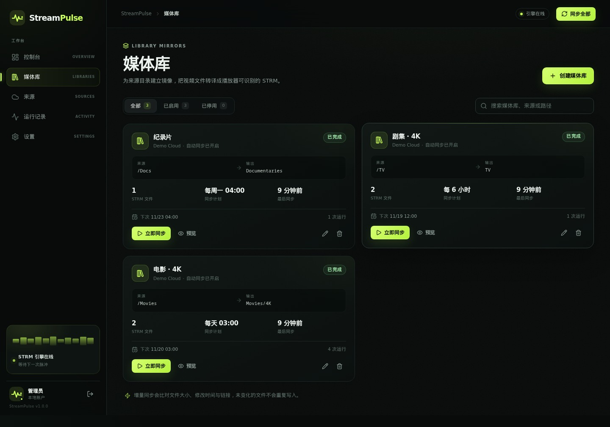
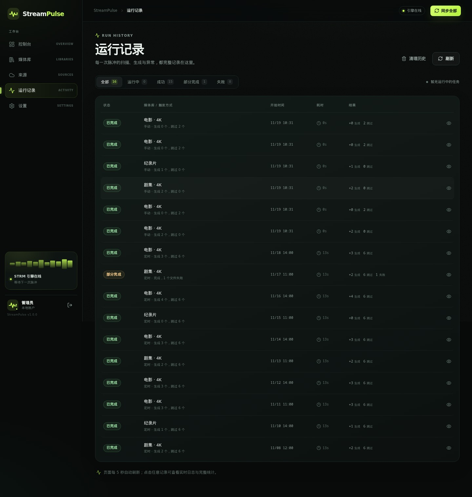
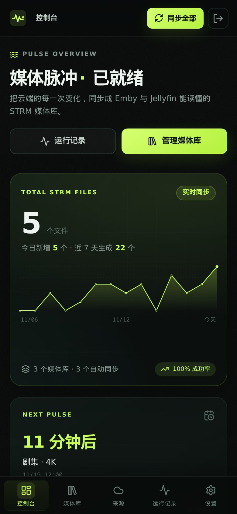

<div align="center">
  
</div>

<h1 align="center">StreamPulse</h1>

<p align="center">
  把 OpenList / AList 云盘媒体，变成 Emby 与 Jellyfin 能原生识别的 STRM 媒体库。
  <br />
  <sub>Scan · Mirror · Pulse</sub>
</p>

<p align="center">
  <a href="https://github.com/DaisyYijin/StreamPulse/actions/workflows/ci.yml"></a>
  <a href="https://github.com/DaisyYijin/StreamPulse/actions/workflows/docker.yml"></a>
  <a href="https://github.com/DaisyYijin/StreamPulse/pkgs/container/streampulse"></a>
  
  
</p>


<details>
<summary><b>查看更多界面截图</b></summary>
<br />

| 媒体库 | 运行记录 |
| --- | --- |
|  |  |

| 实时任务日志 | 系统设置 |
| --- | --- |
|  |  |

| 来源连接 | 登录 / 首次初始化 |
| --- | --- |
|  |  |

</details>

## 手机端

StreamPulse 的手机界面不是简单缩放桌面版：底部固定导航、任务卡片、全屏表单和
安全区适配都已针对触屏重新排布，可以直接在手机浏览器中完成连接来源、创建媒体库、
立即同步、查看实时日志和修改设置。



手机访问 `http://NAS_IP:1024` 即可。通过浏览器菜单选择“添加到主屏幕”，可以获得
接近原生 App 的独立窗口体验；已提供 PWA manifest 和 iPhone / Android 图标。

## 这是什么？

StreamPulse 是一个自托管的 **STRM 媒体库生成器**。它通过 OpenList / AList API
递归扫描网盘目录，并在本地镜像出同样的文件夹结构，为每个视频生成一个轻量的
`.strm` 文件。默认情况下，文件内容指向 StreamPulse 的 2048 端口，由它解析并
`302` 跳转到云盘直链；Emby、Jellyfin 或 Infuse 读取后即可把云盘内容当作本地媒体播放。

- **不中转视频流量**：StreamPulse 只做一次 302 解析，播放流量由播放器直接连接网盘。
- **不复制大文件**：只写几行文本，扫描与更新都非常轻。
- **不需要数据库**：单个容器、一个数据卷即可运行。

## 功能

| | |
| --- | --- |
| **OpenList / AList** | 兼容 Alist v3 API，支持访问令牌或用户名密码登录，连接测试与目录浏览器。 |
| **目录镜像** | 递归保留电影、剧集、季目录结构，输出可直接挂载给媒体服务器。 |
| **STRM 模板** | `{streamBase}`、`{streamToken}`、`{sourceUrl}`、`{encodedPath}` 等变量自由组合。 |
| **双端口 302** | Web 控制台与播放器直链服务分离；STRM 指向本地 302 端口，由 StreamPulse 解析网盘直链后跳转。 |
| **增量同步** | 对比文件大小、修改时间与最终 URL；未变化且文件存在时跳过写入。 |
| **精准过滤** | 视频扩展名、最小文件大小、glob 排除规则，自动忽略隐藏目录与回收站。 |
| **定时脉冲** | 每个媒体库独立的 5 段 Cron 表达式，按指定时区自动同步。 |
| **失效清理** | 可选删除源文件已消失、且由 StreamPulse 记录的 `.strm`，不碰用户自己的文件。 |
| **实时运行台** | SSE 实时日志、取消任务、统计扫描 / 生成 / 跳过 / 失败数量，历史记录可回看。 |
| **手机适配** | 响应式布局、底部五栏导航、移动端任务卡片、全屏表单，支持添加到手机主屏幕。 |
| **安全默认** | 首次启动设置管理员账号与密码，之后可在界面修改；scrypt 加盐散列、HMAC 会话 Cookie。 |
| **Docker 优先** | 单镜像、多架构（amd64 / arm64）、健康检查、GHCR 自动发布。 |

## 快速开始

### 1. 使用 Docker 运行

```bash
mkdir -p streampulse/{config,data,strm,logs}
cd streampulse

docker run -d \
  --name streampulse \
  --restart unless-stopped \
  -p 1024:1024 \
  -p 2048:2048 \
  -v "$(pwd)/config:/config" \
  -v "$(pwd)/data:/data" \
  -v "$(pwd)/strm:/strm" \
  -v "$(pwd)/logs:/logs" \
  -e TZ=Asia/Shanghai \
  ghcr.io/daisyyijin/streampulse:latest
```

打开 `http://你的服务器地址:1024`，首次访问会要求创建**管理员账号和密码**。

> **两个端口都要映射：**
>
> - `1024`：Web 控制台 / API
> - `2048`：给 Emby / Jellyfin 使用的 302 直链服务
>
> 容器内部监听同样的端口。若宿主机端口冲突，只需修改 `-p` 左侧的值，
> 同时把 302 服务地址改成新的宿主机端口。

### 2. 或使用 Docker Compose

仓库内已附带 [`docker-compose.yml`](docker-compose.yml)。推荐先创建 `.env`：

```bash
cp .env.example .env
# 编辑 .env：设置管理员账号密码、302 地址等
docker compose up -d
docker compose logs -f
```

默认映射：

```text
./config → /config 设置、管理员账号、来源账号、媒体库定义
./data   → /data   运行历史、增量清单
./strm   → /strm   STRM 文件
./logs   → /logs   应用日志
```

升级：

```bash
docker compose pull
docker compose up -d
```

### 3. 连接 OpenList

1. 确认 OpenList / AList 可从 StreamPulse 容器访问。
2. 在 StreamPulse 的 **来源 → 连接来源** 中填写 API 地址，例如
   `http://192.168.1.20:5244`。
3. **公开访问地址** 是可选项，仅在 302 解析失败时作为回退地址。
   - 使用默认 302 模式时，Emby 只需要访问 StreamPulse，不需要直接访问 OpenList。
   - 若 OpenList 与 StreamPulse 在同一网络，可留空。
   - 若你使用 `{sourceUrl}` 直连模板，则必须填写播放器可访问的地址。
4. 选择访问令牌或用户名密码，点击保存，然后使用 **测试** 验证连接。

访问令牌位置：OpenList → **设置 → 其他 → 令牌**。

### 4. 创建媒体库

1. 点击 **媒体库 → 创建媒体库**。
2. 选择来源，浏览并选中媒体目录，例如 `/Movies`。
3. 设置输出目录，例如 `Movies/4K`（相对于 `/strm`）。
4. 按需修改 URL 模板、扩展名、排除规则与定时计划。
5. 保存后点击 **立即同步**。

生成的目录会像这样：

```text
/strm/Movies/4K/
├── Dune Part Two (2024)/
│   └── Dune.Part.Two.2024.2160p.HDR.strm
└── Inception (2010)/
    └── Inception.2010.2160p.strm
```

`.strm` 内容（默认 302 模式）：

```text
http://192.168.1.10:2048/r/9f3c...c21/Movies/Inception%20(2010)/Inception.2010.2160p.mkv
```

Emby 请求这个本地地址后，StreamPulse 会调用 OpenList API 解析真实直链并返回
`302`，播放器再直接连接网盘。真实直链不会写进 STRM，OpenList 也不需要暴露给
播放器。

### 5. 接入 Emby / Jellyfin

把宿主机的 `./strm`（或其中的 `Movies/4K`）映射给媒体服务器，然后添加对应的媒体库：

```yaml
volumes:
  - ./streampulse/strm:/media/streampulse:ro
```

媒体服务器里选择 `/media/streampulse/Movies/4K` 即可。扫描完成后，海报与
元数据仍由 Emby / Jellyfin 正常刮削。

> **重要：** 302 模式要求 Emby 能访问 `2048` 端口，StreamPulse 容器能访问
> OpenList API。若解析失败，StreamPulse 会回退到 OpenList 的 `/d/` 地址，这时
> 才需要播放器能直接访问 OpenList。详见 [FAQ](#faq)。

## 管理员账号

首次访问 `http://NAS_IP:1024` 时会创建管理员账号：

- 账号：3–32 位字母、数字、点、下划线或短横线，默认 `admin`
- 密码：至少 8 个字符
- 没有默认密码，首次安装必须自行设置

登录后在 **设置 → 管理员账号与安全** 可以修改账号和密码：

- 修改账号或密码都需要验证当前密码
- 新密码留空表示只改账号
- 修改后会注销其他已登录会话

也可以完全用环境变量管理：

```ini
STREAMPULSE_USERNAME=admin
STREAMPULSE_PASSWORD=你的强密码
```

设置 `STREAMPULSE_PASSWORD` 后，网页首次初始化会被跳过，界面中的账号修改会被锁定；
修改 `.env` 后执行 `docker compose up -d --force-recreate` 生效。

> 当前是单管理员模式，没有多用户。管理员账号文件为
> `/config/accounts/<username>.json`；每个来源的完整账号/凭据在
> `/config/sources/<source-id>.json`，权限均为 0600。

## 双端口与 302 模式

StreamPulse 同时监听两个 HTTP 服务：

| 端口 | 用途 | 谁访问 |
| --- | --- | --- |
| `1024` | Web 控制台、REST API、SSE 日志 | 浏览器 / 管理员 |
| `2048` | 302 直链解析 | Emby / Jellyfin / Infuse |

默认 STRM 模板：

```text
{streamBase}/r/{streamToken}{encodedPath}
```

请求流程：

```text
Emby ──► StreamPulse:2048/r/<key>/Movies/xxx.mkv
             │  使用来源令牌调用 OpenList /api/fs/get
             ▼
        302 Location: https://网盘真实直链...
             │
Emby ◄───────┘  直接向网盘发起 Range 请求
```

- `{streamBase}`：在 **设置 → 302 服务公开地址** 配置，例如
  `http://192.168.1.10:2048`。首次通过浏览器创建媒体库时，如果留空，会自动按
  当前访问地址推断。
- `{streamToken}`：每个来源随机生成的 302 密钥，不在界面中显示明文，也不需要手动填写。
- 302 服务只接受 `/r/<key>/...` 请求，密钥不可猜测；它不会暴露管理员 API。

如果 Emby 与 StreamPulse 不在同一台机器，请把 302 服务地址改成 Emby 实际能访问的
内网 IP 或域名，而不是 `127.0.0.1`。

## URL 模板

默认模板：

```text
{streamBase}/r/{streamToken}{encodedPath}
```

| 变量 | 含义 | 示例 |
| --- | --- | --- |
| `{streamBase}` | 302 服务公开地址，自动去掉末尾 `/` | `http://192.168.1.10:2048` |
| `{streamToken}` | 当前来源的 302 路由密钥 | `9f3c...c21` |
| `{sourceUrl}` | 来源的公开地址（未设置时回落 API 地址） | `https://cloud.example.com` |
| `{encodedPath}` | 完整路径，逐段 URL 编码，**推荐用于直链** | `/Movies/Dune%20Part%20Two.mkv` |
| `{path}` | 完整原始路径，不做编码 | `/Movies/Dune Part Two.mkv` |
| `{file}` | 含扩展名的文件名 | `Dune Part Two.mkv` |
| `{name}` | 不含扩展名的文件名 | `Dune Part Two` |
| `{ext}` | 小写扩展名 | `mkv` |
| `{dir}` | 文件所在目录 | `/Movies` |

模板必须包含 `{encodedPath}` 或 `{path}`，最终结果必须是 `http` / `https` URL。

常见写法：

```text
# 默认：通过 StreamPulse 2048 做 302 跳转
{streamBase}/r/{streamToken}{encodedPath}

# 直连 OpenList /d/（不使用 302 服务）
{sourceUrl}/d{encodedPath}

# OpenList 预览 / 在线播放
{sourceUrl}/p{encodedPath}
```

> 文件名含空格、`#`、中文时，`{path}` 可能破坏 URL 结构。请优先使用
> `{encodedPath}`。

## 环境变量

| 变量 | 默认值 | 说明 |
| --- | --- | --- |
| `PORT` | `1024` | Web 控制台监听端口。 |
| `STREAM_PORT` | `2048` | 302 直链服务监听端口。 |
| `STREAM_PUBLIC_URL` | 空 | 302 服务公开地址，例如 `http://192.168.1.10:2048`；空则首次创建媒体库时自动推断。 |
| `HOST` | `0.0.0.0` | 监听地址。 |
| `CONFIG_DIR` | `/config` | 设置、管理员账号、来源账号、媒体库定义。旧版 `DATA_DIR` 仍兼容。 |
| `STATE_DIR` | `/data` | 运行历史、增量清单等运行状态。 |
| `OUTPUT_DIR` | `/strm` | STRM 输出根目录；也可在界面设置中修改（需绝对路径且可写）。 |
| `LOG_DIR` | `/logs` | 应用日志目录，按天写入 `streampulse-YYYY-MM-DD.log`。 |
| `LOG_RETENTION_DAYS` | `14` | 自动清理超过天数的旧日志。 |
| `STREAMPULSE_USERNAME` | `admin` | 环境变量管理模式下使用的管理员账号。 |
| `STREAMPULSE_PASSWORD` | 空 | 设置后跳过首次初始化，并锁定界面中的账号/密码修改。 |
| `TZ` | `Asia/Shanghai` | 容器时区；Cron 的默认时区来自界面设置。 |
| `TRUST_PROXY` | `false` | 置于 HTTPS 反向代理后时设为 `true`，以正确签发 Secure Cookie。 |
| `STREAMPULSE_VERSION` | 构建版本 | 覆盖界面展示的版本号，一般无需设置。 |

四个目录的职责：

| 宿主机 | 容器内 | 内容 |
| --- | --- | --- |
| `./config` | `/config` | `settings.json`、`accounts/`、`sources/`、`libraries/` |
| `./data` | `/data` | `runs/`、`manifests/` |
| `./strm` | `/strm` | 生成的 `.strm` 文件 |
| `./logs` | `/logs` | 每日应用日志 |

```text
/config/
├── settings.json             # 全局设置 + 会话密钥（0600）
├── accounts/
│   └── owner.json            # 一个管理员账号一个文件（0600）
├── sources/
│   ├── src_xxx.json          # 一个来源一个完整文件（含 token/密码，0600）
│   └── src_yyy.json
└── libraries/
    ├── lib_xxx.json          # 一个媒体库一个文件（0600）
    └── lib_yyy.json

/data/
├── runs/
│   └── run_xxx.json          # 一个任务一个文件（含该任务日志）
└── manifests/
    └── lib_xxx.json          # 每个媒体库的增量清单

/strm/                        # 生成的 STRM 文件
/logs/                        # streampulse-YYYY-MM-DD.log
```

拆分为：

- 管理员账号：`/config/accounts/<username>.json`
- 每个来源/115/其他 Token：`/config/sources/<source-id>.json`
- 每个媒体库：`/config/libraries/<library-id>.json`
- 每个运行任务：`/data/runs/<run-id>.json`
- 增量清单：`/data/manifests/<library-id>.json`

配置、状态、输出、日志互不混合。凭据文件权限为 `0600`，不会写入 `/strm` 或
`/logs`。**备份 `/config`、`/data` 和 `/strm`**；日志目录按需备份。

### 115 / 其他网盘的账号存储

StreamPulse 不直接保存 115 密码。正确方式是：

1. 在 OpenList / AList 中添加 115 或其他网盘存储；
2. 在 OpenList 获取访问令牌，或准备 OpenList 管理员账号；
3. 在 StreamPulse 的 **来源** 中连接 OpenList。

因此每个来源的 `/config/sources/<source-id>.json` 保存的是该来源的完整
**OpenList 凭据**，由它再访问 115。
如果你需要直接填写 115 账号（不经 OpenList），那是另一套原生驱动，需要单独开发。

## 从 1.4 升级

1.5 把运行状态从配置中拆到 `/data`，并把媒体库、任务也改成一文件一条记录。

1.4 的配置在 `config/streampulse.json`，1.5 会在首次启动时自动迁移：

```bash
docker compose pull
docker compose up -d --force-recreate
```

启动后会自动生成：

- `config/settings.json`
- `config/accounts/<username>.json`
- `config/sources/<source-id>.json`
- `config/libraries/<library-id>.json`
- `data/runs/<run-id>.json`
- `data/manifests/<library-id>.json`

旧 `streampulse.json` 在迁移完成后会被删除，避免凭据残留第二份。

如果旧配置在 `data` 目录，可临时设置：

```yaml
environment:
  CONFIG_DIR: /data
volumes:
  - ./data:/data
```

迁移完成后建议改回 `CONFIG_DIR=/config`。

## 从源码运行

要求 Node.js ≥ 22.12（推荐 24）。

```bash
npm ci
npm run dev
```

- 前端开发服务器：`http://localhost:5173`（自动代理 `/api` 到 1024）
- Web API：`http://localhost:1024`
- 302 服务：`http://localhost:2048`

生产构建与本地启动：

```bash
npm run build
CONFIG_DIR=./config STATE_DIR=./data OUTPUT_DIR=./strm LOG_DIR=./logs PORT=1024 STREAM_PORT=2048 npm start
```

质量检查：

```bash
npm run typecheck
npm test
```

## Docker 镜像与 GitHub Actions

仓库包含两条工作流：

- [`ci.yml`](.github/workflows/ci.yml)：推送与 PR 时执行类型检查、单元测试、生产构建。
- [`docker.yml`](.github/workflows/docker.yml)：在 `main` 分支和 `v*.*.*` 标签上构建
  `linux/amd64` + `linux/arm64` 镜像并推送到 GitHub Container Registry。

镜像地址：

```text
ghcr.io/daisyyijin/streampulse:latest
ghcr.io/daisyyijin/streampulse:sha-<commit>
ghcr.io/daisyyijin/streampulse:1.5.0
```

### 首次发布后设为公开

GitHub 的 GHCR 包默认可能是私有。若希望匿名 `docker pull`：

1. 打开仓库右侧 **Packages**，或个人主页 → **Packages** → `streampulse`。
2. **Package settings → Danger Zone → Change visibility → Public**。

私有包也可以使用：

```bash
echo "$GITHUB_PAT" | docker login ghcr.io -u DaisyYijin --password-stdin
docker pull ghcr.io/daisyyijin/streampulse:latest
```

PAT 需要 `read:packages` 权限。

### 本地构建镜像

```bash
docker build -t streampulse:local .
docker run --rm -p 1024:1024 -p 2048:2048 \
  -v "$(pwd)/config:/config" -v "$(pwd)/data:/data" \
  -v "$(pwd)/strm:/strm" -v "$(pwd)/logs:/logs" \
  streampulse:local
```

## 工作原理

```text
OpenList / AList
      │  /api/fs/list（递归）
      ▼
  Scanner ──► 过滤扩展名 / 大小 / glob
      │
      ▼
  URL Renderer（{streamBase}/r/{streamToken}{encodedPath}）
      │
      ▼
  Incremental Planner ◄── manifests/<library>.json
      │
      ▼
  /strm/**/*.strm
      │
      ▼
Emby / Jellyfin ──► StreamPulse:2048 ──302──► 网盘真实直链
```

任务由内置队列管理，默认最多同时运行 2 个媒体库（可在设置中调整 1–4）。
定时任务使用 `node-cron`，时区与 Cron 表达式均可在界面配置。运行日志通过
Server-Sent Events 实时推送到浏览器。

## API

所有 `/api/*` 接口除健康检查与登录外都需要会话 Cookie。

| 方法 | 路径 | 用途 |
| --- | --- | --- |
| `GET` | `/api/health` | Web 健康检查（供 Docker 使用）。 |
| `GET` | `:2048/health` | 302 服务健康检查。 |
| `GET` | `/api/overview` | 控制台统计。 |
| `GET/POST` | `/api/sources` | 来源列表 / 新建来源。 |
| `POST` | `/api/sources/:id/test` | 测试 OpenList 连接。 |
| `GET` | `/api/sources/:id/browse?path=/` | 浏览远程目录。 |
| `GET/POST` | `/api/libraries` | 媒体库列表 / 新建。 |
| `POST` | `/api/libraries/:id/run` | 立即同步。 |
| `POST` | `/api/libraries/:id/preview` | 只读预览扫描与 STRM 路径。 |
| `GET` | `/api/runs` | 运行历史。 |
| `GET` | `/api/runs/:id/events` | SSE 实时日志。 |
| `POST` | `/api/runs/:id/cancel` | 取消任务。 |
| `GET/PATCH` | `/api/settings` | 系统设置。 |

## 安全说明

- 管理员账号与密码使用 **scrypt** 加盐散列；会话是 HMAC-SHA256 签名的 HttpOnly Cookie。
- 登录接口有基础限流（每个 IP 15 分钟 12 次失败）。
- 管理员账号在 `/config/accounts/<username>.json`，来源令牌/密码在 `/config/sources/<id>.json`，列表接口只返回末尾提示。
- 首次启动的初始化接口在管理员账号设置后自动失效。
- 建议通过 HTTPS 反向代理访问，并设置 `TRUST_PROXY=true`。
- 不要将 `/config` 暴露到公网；来源凭据在 `sources/` 中以明文存储。
- 本项目不会删除清单之外的文件；删除媒体库也不会删除已生成的 STRM。
- 302 链接中的随机密钥可以访问该来源的直链解析，请像密码一样保护 STRM 文件。

## FAQ

**Q：Emby 能看到文件，但播放 401 / 403？**

先确认 Emby 能访问 `2048` 端口，并且 **设置 → 302 服务公开地址** 填写的是
Emby 实际可达的地址（不是 `127.0.0.1`）。再检查 StreamPulse 容器能否访问
OpenList API、来源令牌是否有效。

如果任务日志显示 302 解析失败并回退到 OpenList `/d/`，则播放器还需要能直接
访问 OpenList，且目标文件需允许游客访问或直链可公开访问。

**Q：媒体库扫描不到文件？**

检查：来源目录是否选对、扩展名过滤、最小文件大小、排除 glob，以及任务日志
中的「扫描完成 / 匹配」数量。可先用媒体库卡片的 **预览** 功能做只读试运行。

**Q：为什么有时不重新生成？**

增量模式会比对文件大小、修改时间与最终 URL，并检查 `.strm` 是否存在。三者
都没变时会跳过。需要强制重建时，临时关闭该媒体库的「增量同步」并运行一次。

**Q：中文、空格、括号文件名会出问题吗？**

默认模板使用 `{encodedPath}`，会逐段编码，兼容性最好。不要手动把
`{encodedPath}` 换成 `{path}`，除非你确定路径中没有需要编码的字符。

**Q：忘记管理员密码怎么办？**

停止容器，二选一：

1. 在 `.env` 设置 `STREAMPULSE_USERNAME` / `STREAMPULSE_PASSWORD` 后重建容器；
2. 停止容器，删除 `/config/accounts/*.json`，重启后重新进入首次初始化（不会删除媒体库和来源）。

编辑前请先备份数据卷，且不要在服务运行时修改数据库文件。

**Q：Docker 提示输出目录不可写？**

默认的 `/config`、`/data`、`/strm`、`/logs` 会由入口脚本调整给容器用户。若你把
`OUTPUT_DIR` 或 `LOG_DIR` 指向其他挂载目录，请确保容器 UID `1000` 对该目录有
写权限，或使用 `docker compose` 中的 `user:` 指定有权限的 UID/GID。

**Q：支持 ARM / 群晖 / 威联通吗？**

镜像同时构建 `linux/amd64` 与 `linux/arm64`。只要宿主机能运行 Docker，
即可使用；注意为数据目录选择正确的挂载路径。

**Q：会产生大量网络流量吗？**

扫描只调用目录列表 API。默认 302 模式下，StreamPulse 只负责一次轻量的
直链解析和 302 响应，播放流量由播放器直接连接网盘，不经过 StreamPulse。
生成 STRM 本身只写入极小文本文件。

## 项目结构

```text
src/
├── server/           # Express API、扫描器、任务队列、OpenList 客户端
│   ├── core/         # 路径安全、URL 模板、清单（含单元测试）
│   ├── api/          # REST 路由、校验与序列化
│   ├── runner.ts     # 队列 / 增量生成 / SSE 事件
│   ├── scheduler.ts  # Cron 调度
│   ├── stream.ts     # 2048 端口 302 直链服务
│   └── index.ts      # 双端口服务入口与静态资源
├── shared/           # 前后端共享类型与常量
└── web/              # React 19 + Vite 控制台
docs/                 # 截图与横幅
```

## 参与贡献

欢迎 Issue 与 Pull Request。提交前请运行：

```bash
npm run typecheck && npm test && npm run build
```

请勿在 Issue 中粘贴真实令牌、密码或包含隐私的目录结构。

## License

[MIT](LICENSE) © 2026 StreamPulse contributors
