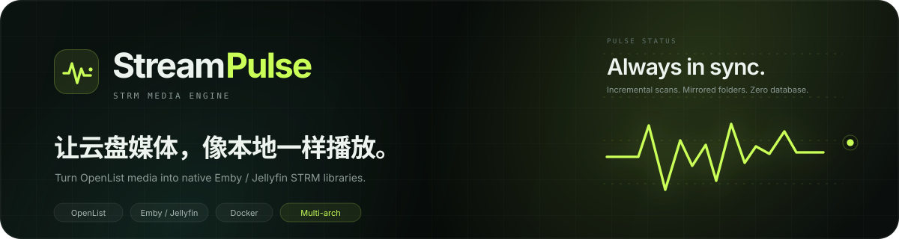
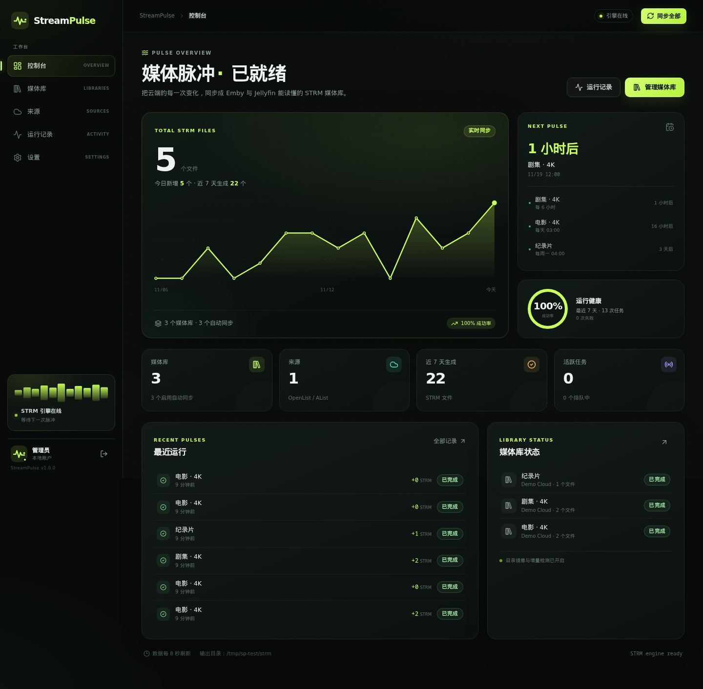
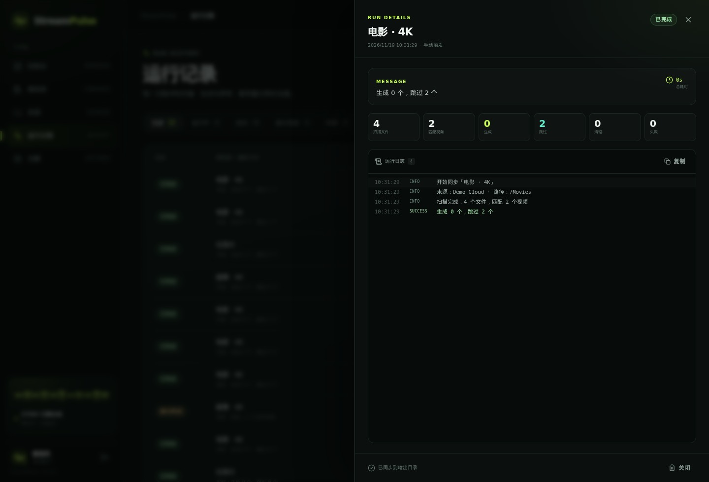
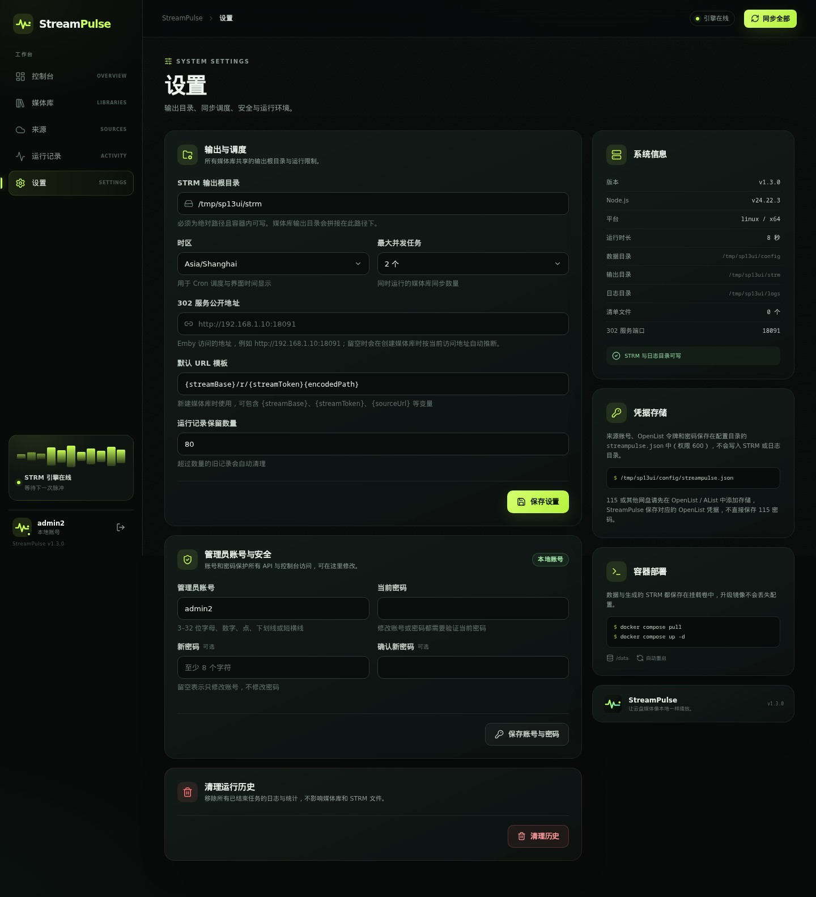
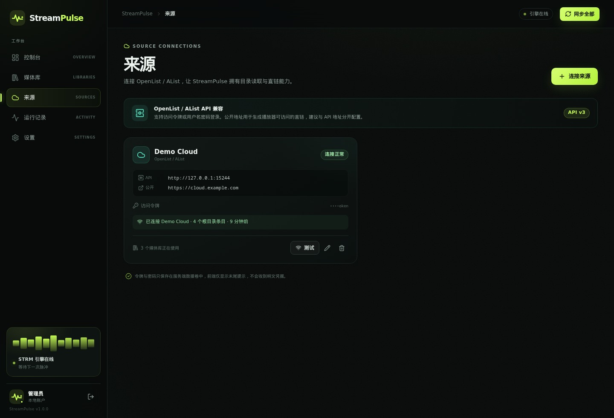
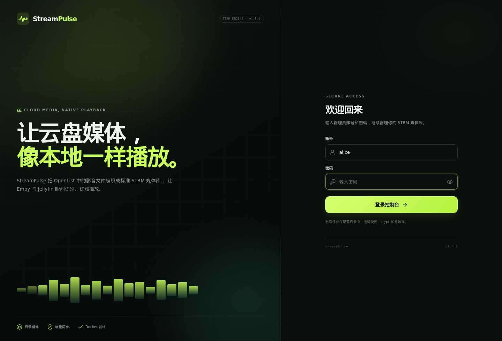

<div align="center">
  
</div>

<h1 align="center">StreamPulse</h1>

<p align="center">
  把 OpenList / AList 云盘媒体，变成 Emby 与 Jellyfin 能原生识别的 STRM 媒体库。
  <br />
  <sub>Scan · Mirror · Pulse</sub>
</p>

<p align="center">
  <a href="https://github.com/DaisyYijin/StreamPulse/actions/workflows/ci.yml"></a>
  <a href="https://github.com/DaisyYijin/StreamPulse/actions/workflows/docker.yml"></a>
  <a href="https://github.com/DaisyYijin/StreamPulse/pkgs/container/streampulse"></a>
  
  
</p>



<details>
<summary><b>查看更多界面截图</b></summary>
<br />

| 媒体库 | 运行记录 |
| --- | --- |
|  |  |

| 实时任务日志 | 系统设置 |
| --- | --- |
|  |  |

| 来源连接 | 登录 / 首次初始化 |
| --- | --- |
|  |  |

</details>

## 这是什么？

StreamPulse 是一个自托管的 **STRM 媒体库生成器**。它通过 OpenList / AList API
递归扫描网盘目录，并在本地镜像出同样的文件夹结构，为每个视频生成一个轻量的
`.strm` 文件。文件内容是指向云盘直链的 URL，Emby、Jellyfin 或 Infuse
读取后即可把云盘内容当作本地媒体播放。

- **不代理视频流量**：播放器直接连接你的 OpenList 直链。
- **不复制大文件**：只写几行文本，扫描与更新都非常轻。
- **不需要数据库**：单个容器、一个数据卷即可运行。

## 功能

| | |
| --- | --- |
| **OpenList / AList** | 兼容 Alist v3 API，支持访问令牌或用户名密码登录，连接测试与目录浏览器。 |
| **目录镜像** | 递归保留电影、剧集、季目录结构，输出可直接挂载给媒体服务器。 |
| **STRM 模板** | `{sourceUrl}`、`{encodedPath}`、`{path}` 等变量自由组合，支持 `/d/` 直链与 `/p/` 预览。 |
| **增量同步** | 对比文件大小、修改时间与最终 URL；未变化且文件存在时跳过写入。 |
| **精准过滤** | 视频扩展名、最小文件大小、glob 排除规则，自动忽略隐藏目录与回收站。 |
| **定时脉冲** | 每个媒体库独立的 5 段 Cron 表达式，按指定时区自动同步。 |
| **失效清理** | 可选删除源文件已消失、且由 StreamPulse 记录的 `.strm`，不碰用户自己的文件。 |
| **实时运行台** | SSE 实时日志、取消任务、统计扫描 / 生成 / 跳过 / 失败数量，历史记录可回看。 |
| **安全默认** | 首次启动设置管理员密码，scrypt 加盐散列，HMAC 会话 Cookie，来源密钥不回传浏览器。 |
| **Docker 优先** | 单镜像、多架构（amd64 / arm64）、健康检查、GHCR 自动发布。 |

## 快速开始

### 1. 使用 Docker 运行

```bash
mkdir -p streampulse/data
cd streampulse

docker run -d \
  --name streampulse \
  --restart unless-stopped \
  -p 8088:8080 \
  -v "$(pwd)/data:/data" \
  -e TZ=Asia/Shanghai \
  ghcr.io/daisyyijin/streampulse:latest
```

打开 `http://你的服务器地址:8088`，首次访问会要求创建管理员密码。

> 8088 只是推荐端口，你可以换成任何空闲端口。容器内部始终监听 `8080`。
> 端口冲突时修改 `-p` 左侧的值即可。

### 2. 或使用 Docker Compose

仓库内已附带 [`docker-compose.yml`](docker-compose.yml)：

```bash
docker compose up -d
docker compose logs -f
```

默认映射 `8088:8080`，数据保存在 `./data`。升级：

```bash
docker compose pull
docker compose up -d
```

### 3. 连接 OpenList

1. 确认 OpenList / AList 可从 StreamPulse 容器访问。
2. 在 StreamPulse 的 **来源 → 连接来源** 中填写 API 地址，例如
   `http://192.168.1.20:5244`。
3. **公开访问地址** 填播放器实际能访问的地址，例如 `https://cloud.example.com`。
   - 若与 API 地址相同，可留空。
   - 若 Emby 与 OpenList 在同一内网，可填内网地址；否则请填公网域名。
4. 选择访问令牌或用户名密码，点击保存，然后使用 **测试** 验证连接。

访问令牌位置：OpenList → **设置 → 其他 → 令牌**。

### 4. 创建媒体库

1. 点击 **媒体库 → 创建媒体库**。
2. 选择来源，浏览并选中媒体目录，例如 `/Movies`。
3. 设置输出目录，例如 `Movies/4K`（相对于 `/data/strm`）。
4. 按需修改 URL 模板、扩展名、排除规则与定时计划。
5. 保存后点击 **立即同步**。

生成的目录会像这样：

```text
/data/strm/Movies/4K/
├── Dune Part Two (2024)/
│   └── Dune.Part.Two.2024.2160p.HDR.strm
└── Inception (2010)/
    └── Inception.2010.2160p.strm
```

`.strm` 内容：

```text
https://cloud.example.com/d/Movies/Inception%20(2010)/Inception.2010.2160p.mkv
```

### 5. 接入 Emby / Jellyfin

把 `/data/strm`（或其中的 `Movies/4K`）映射给媒体服务器，然后添加对应的媒体库：

```yaml
volumes:
  - ./streampulse/data/strm:/media/streampulse
```

媒体服务器里选择 `/media/streampulse/Movies/4K` 即可。扫描完成后，海报与
元数据仍由 Emby / Jellyfin 正常刮削。

> **重要：** 播放器必须能直接访问 STRM 中的 URL。OpenList 中对应文件需要允许
> 游客访问，或者你的直链本身可公开访问。否则播放器会收到 401，这是权限问题，
> 不是 STRM 生成问题。详见 [FAQ](#faq)。

## URL 模板

默认模板：

```text
{sourceUrl}/d{encodedPath}
```

| 变量 | 含义 | 示例 |
| --- | --- | --- |
| `{sourceUrl}` | 来源的公开地址（未设置时回落 API 地址），自动去掉末尾 `/` | `https://cloud.example.com` |
| `{encodedPath}` | 完整路径，逐段 URL 编码，**推荐用于直链** | `/Movies/Dune%20Part%20Two.mkv` |
| `{path}` | 完整原始路径，不做编码 | `/Movies/Dune Part Two.mkv` |
| `{file}` | 含扩展名的文件名 | `Dune Part Two.mkv` |
| `{name}` | 不含扩展名的文件名 | `Dune Part Two` |
| `{ext}` | 小写扩展名 | `mkv` |
| `{dir}` | 文件所在目录 | `/Movies` |

模板必须包含 `{encodedPath}` 或 `{path}`，最终结果必须是 `http` / `https` URL。

常见写法：

```text
# OpenList 直链下载
{sourceUrl}/d{encodedPath}

# 使用预览 / 在线播放路径
{sourceUrl}/p{encodedPath}
```

> 文件名含空格、`#`、中文时，`{path}` 可能破坏 URL 结构。请优先使用
> `{encodedPath}`。

## 环境变量

| 变量 | 默认值 | 说明 |
| --- | --- | --- |
| `PORT` | `8080` | 容器内监听端口。 |
| `HOST` | `0.0.0.0` | 监听地址。 |
| `DATA_DIR` | `/data` | 数据库、清单和默认输出目录所在的数据卷。 |
| `OUTPUT_DIR` | `/data/strm` | 默认 STRM 输出根目录；也可在界面设置中修改（需绝对路径且可写）。 |
| `STREAMPULSE_PASSWORD` | 空 | 设置后跳过首次初始化，并锁定界面中的密码修改。 |
| `TZ` | `Asia/Shanghai` | 容器时区；Cron 的默认时区来自界面设置。 |
| `TRUST_PROXY` | `false` | 置于 HTTPS 反向代理后时设为 `true`，以正确签发 Secure Cookie。 |
| `STREAMPULSE_VERSION` | 构建版本 | 覆盖界面展示的版本号，一般无需设置。 |

`DATA_DIR` 中会包含：

```text
/data/
├── streampulse.json      # 配置、来源凭据、运行历史（权限 0600）
├── manifests/            # 每个媒体库的增量清单
└── strm/                 # 默认输出目录
```

**备份只需要备份整个 `/data`**。凭据以明文 JSON 保存在数据卷中，请确保宿主机
磁盘与备份的访问权限受控。

## 从源码运行

要求 Node.js ≥ 22.12（推荐 24）。

```bash
npm ci
npm run dev
```

- 前端开发服务器：`http://localhost:5173`（自动代理 `/api` 到 8080）
- API 服务：`http://localhost:8080`

生产构建与本地启动：

```bash
npm run build
DATA_DIR=./data OUTPUT_DIR=./data/strm PORT=8080 npm start
```

质量检查：

```bash
npm run typecheck
npm test
```

## Docker 镜像与 GitHub Actions

仓库包含两条工作流：

- [`ci.yml`](.github/workflows/ci.yml)：推送与 PR 时执行类型检查、单元测试、生产构建。
- [`docker.yml`](.github/workflows/docker.yml)：在 `main` 分支和 `v*.*.*` 标签上构建
  `linux/amd64` + `linux/arm64` 镜像并推送到 GitHub Container Registry。

镜像地址：

```text
ghcr.io/daisyyijin/streampulse:latest
ghcr.io/daisyyijin/streampulse:sha-<commit>
ghcr.io/daisyyijin/streampulse:1.0.0
```

### 首次发布后设为公开

GitHub 的 GHCR 包默认可能是私有。若希望匿名 `docker pull`：

1. 打开仓库右侧 **Packages**，或个人主页 → **Packages** → `streampulse`。
2. **Package settings → Danger Zone → Change visibility → Public**。

私有包也可以使用：

```bash
echo "$GITHUB_PAT" | docker login ghcr.io -u DaisyYijin --password-stdin
docker pull ghcr.io/daisyyijin/streampulse:latest
```

PAT 需要 `read:packages` 权限。

### 本地构建镜像

```bash
docker build -t streampulse:local .
docker run --rm -p 8088:8080 -v "$(pwd)/data:/data" streampulse:local
```

## 工作原理

```text
OpenList / AList
      │  /api/fs/list（递归）
      ▼
  Scanner ──► 过滤扩展名 / 大小 / glob
      │
      ▼
  URL Renderer（模板变量）
      │
      ▼
  Incremental Planner ◄── manifests/<library>.json
      │
      ▼
  /data/strm/**/*.strm  ──►  Emby / Jellyfin / Infuse
```

任务由内置队列管理，默认最多同时运行 2 个媒体库（可在设置中调整 1–4）。
定时任务使用 `node-cron`，时区与 Cron 表达式均可在界面配置。运行日志通过
Server-Sent Events 实时推送到浏览器。

## API

所有 `/api/*` 接口除健康检查与登录外都需要会话 Cookie。

| 方法 | 路径 | 用途 |
| --- | --- | --- |
| `GET` | `/api/health` | 健康检查（供 Docker 使用）。 |
| `GET` | `/api/overview` | 控制台统计。 |
| `GET/POST` | `/api/sources` | 来源列表 / 新建来源。 |
| `POST` | `/api/sources/:id/test` | 测试 OpenList 连接。 |
| `GET` | `/api/sources/:id/browse?path=/` | 浏览远程目录。 |
| `GET/POST` | `/api/libraries` | 媒体库列表 / 新建。 |
| `POST` | `/api/libraries/:id/run` | 立即同步。 |
| `POST` | `/api/libraries/:id/preview` | 只读预览扫描与 STRM 路径。 |
| `GET` | `/api/runs` | 运行历史。 |
| `GET` | `/api/runs/:id/events` | SSE 实时日志。 |
| `POST` | `/api/runs/:id/cancel` | 取消任务。 |
| `GET/PATCH` | `/api/settings` | 系统设置。 |

## 安全说明

- 管理员密码使用 **scrypt** 加盐散列；会话是 HMAC-SHA256 签名的 HttpOnly Cookie。
- 登录接口有基础限流（每个 IP 15 分钟 12 次失败）。
- 来源令牌/密码仅保存在服务端数据卷，列表接口只返回末尾提示。
- 首次启动的初始化接口在密码设置后自动失效。
- 建议通过 HTTPS 反向代理访问，并设置 `TRUST_PROXY=true`。
- 不要将 `/data` 暴露到公网；凭据在其中以明文存储。
- 本项目不会删除清单之外的文件；删除媒体库也不会删除已生成的 STRM。

## FAQ

**Q：Emby 能看到文件，但播放 401 / 403？**

STRM 里是直链，播放器请求时不会携带 OpenList 的登录 Cookie。请确认
OpenList 中目标目录允许游客访问，或直链本身可公开访问。必要时把来源的
公开访问地址改为外部可访问的域名，并在 OpenList 中放开对应权限。

**Q：媒体库扫描不到文件？**

检查：来源目录是否选对、扩展名过滤、最小文件大小、排除 glob，以及任务日志
中的「扫描完成 / 匹配」数量。可先用媒体库卡片的 **预览** 功能做只读试运行。

**Q：为什么有时不重新生成？**

增量模式会比对文件大小、修改时间与最终 URL，并检查 `.strm` 是否存在。三者
都没变时会跳过。需要强制重建时，临时关闭该媒体库的「增量同步」并运行一次。

**Q：中文、空格、括号文件名会出问题吗？**

默认模板使用 `{encodedPath}`，会逐段编码，兼容性最好。不要手动把
`{encodedPath}` 换成 `{path}`，除非你确定路径中没有需要编码的字符。

**Q：忘记管理员密码怎么办？**

停止容器，二选一：

1. 给容器加上 `STREAMPULSE_PASSWORD=新密码` 环境变量后重启（会覆盖本地密码）；
2. 编辑 `/data/streampulse.json`，把 `"passwordHash"` 改为 `null` 后重启，重新进入首次初始化。

编辑前请先备份数据卷，且不要在服务运行时修改数据库文件。

**Q：Docker 提示输出目录不可写？**

默认数据卷内的 `/data` 会由入口脚本调整给容器用户。若你把 `OUTPUT_DIR`
指向其他挂载目录，请确保容器 UID `1000` 对该目录有写权限，或使用
`docker compose` 中的 `user:` 指定有权限的 UID/GID。

**Q：支持 ARM / 群晖 / 威联通吗？**

镜像同时构建 `linux/amd64` 与 `linux/arm64`。只要宿主机能运行 Docker，
即可使用；注意为数据目录选择正确的挂载路径。

**Q：会产生大量网络流量吗？**

扫描只调用目录列表 API。播放流量由播放器直接连接 OpenList，不经过
StreamPulse。生成 STRM 本身只写入极小文本文件。

## 项目结构

```text
src/
├── server/           # Express API、扫描器、任务队列、OpenList 客户端
│   ├── core/         # 路径安全、URL 模板、清单（含单元测试）
│   ├── api/          # REST 路由、校验与序列化
│   ├── runner.ts     # 队列 / 增量生成 / SSE 事件
│   ├── scheduler.ts  # Cron 调度
│   └── index.ts      # 服务入口与静态资源
├── shared/           # 前后端共享类型与常量
└── web/              # React 19 + Vite 控制台
docs/                 # 截图与横幅
```

## 参与贡献

欢迎 Issue 与 Pull Request。提交前请运行：

```bash
npm run typecheck && npm test && npm run build
```

请勿在 Issue 中粘贴真实令牌、密码或包含隐私的目录结构。

## License

[MIT](LICENSE) © 2026 StreamPulse contributors
